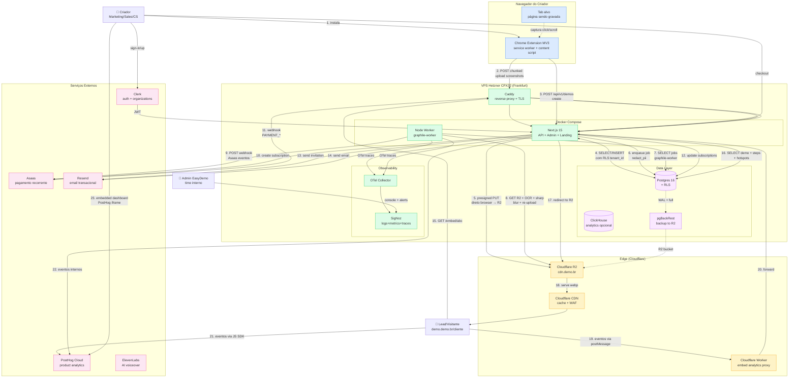

# Diagrama de arquitetura — EasyDemo (clone Supademo BR)

> Visão geral completa do sistema: usuário final → extensão → API → storage → CDN → player público → analytics.

---

## 1. Diagrama Mermaid (alto nível)



---

## 2. Fluxo detalhado — Criação de demo

```
┌─────────────────────────────────────────────────────────────────┐
│ Criador                                                          │
│ 1. instala Chrome extension                                     │
│ 2. navega no app do cliente (ex: app.empresa.com)                │
│ 3. clica "Gravar" no popup da extensão                          │
│ 4. clica em botões, preenche forms, navega menus                 │
│ 5. clica "Parar"                                                │
└─────────────────────────────────────────────────────────────────┘
                              │
                              ▼
┌─────────────────────────────────────────────────────────────────┐
│ Chrome Extension (MV3)                                            │
│ Service Worker:                                                  │
│   - injeta content script no tab                                │
│   - escuta mensagens do content script                          │
│   - chama chrome.tabs.captureVisibleTab() a cada passo          │
│   - chama chrome.scripting.executeScript() para bounding box    │
│   - enfileira eventos em chrome.storage.session                 │
│ Content Script:                                                  │
│   - DOM events (mousedown, input, navigation)                  │
│   - calcula seletor CSS + bounding rect do alvo                 │
│   - envia para SW via runtime.sendMessage                       │
│ Offscreen Document (opcional):                                  │
│   - MediaRecorder para gravação contínua (sandbox mode)        │
│ On Stop:                                                         │
│   - faz POST chunked /api/v1/demos/upload com array de passos   │
│   - aguarda resposta com demo_id                                │
└─────────────────────────────────────────────────────────────────┘
                              │
                              ▼
┌─────────────────────────────────────────────────────────────────┐
│ Next.js API (/api/v1/demos)                                      │
│ - Middleware Clerk: valida JWT                                  │
│ - Drizzle: INSERT INTO demos + demo_steps + hotspots           │
│   com RLS tenant_id = workspace atual                           │
│ - Para cada screenshot:                                         │
│   - GET presigned PUT URL para R2                               │
│   - retorna URL para o SW fazer upload direto                    │
│ - enfileira job graphile-worker 'process_demo'                  │
└─────────────────────────────────────────────────────────────────┘
                              │
                              ▼
┌─────────────────────────────────────────────────────────────────┐
│ Background Worker (graphile-worker)                              │
│ - recebe job 'process_demo'                                     │
│ - para cada step:                                               │
│   1. baixa imagem do R2                                         │
│   2. roda Tesseract.js OCR                                      │
│   3. regex detecta PII (CPF, CNPJ, email, cartão)               │
│   4. sharp aplica blur sobre bounding boxes detectadas           │
│   5. sobe imagem redacted de volta pro R2                        │
│   6. atualiza demo_steps.image_url com URL final                │
│ - se cliente pediu: dispara job 'generate_video_mp4' (Remotion)│
└─────────────────────────────────────────────────────────────────┘
                              │
                              ▼
┌─────────────────────────────────────────────────────────────────┐
│ Editor Web (Next.js /admin/demos/[id]/edit)                     │
│ - mostra preview do demo                                        │
│ - mostra detecções PII com bounding boxes (revisão manual)      │
│ - criador pode adicionar hotspot manual, editar texto            │
│ - "Publicar" → UPDATE demos SET status='published'              │
└─────────────────────────────────────────────────────────────────┘
```

---

## 3. Fluxo detalhado — Visualização pública

```
┌─────────────────────────────────────────────────────────────────┐
│ Lead / Visitante                                                 │
│ Site do cliente (ex: empresa.com.br/produto)                    │
│ <script src="https://embed.demo.br/v1/loader.js" data-easydemo-id="abc">│
└─────────────────────────────────────────────────────────────────┘
                              │
                              ▼ (script injeta iframe)
┌─────────────────────────────────────────────────────────────────┐
│ play.demo.br/embed/abc                                          │
│ Next.js renderiza <DemoPlayer /> React component               │
│ DemoPlayer faz:                                                  │
│  - GET /api/v1/public/demos/abc → JSON do demo                │
│  - GET images do R2 (cdn.demo.br/demos/abc/s1.webp)            │
│  - renderiza imagem + hotspots posicionados em coord fracionárias│
│  - emite eventos: demo_view, step_view, cta_click, etc        │
└─────────────────────────────────────────────────────────────────┘
                              │
                              ▼ (eventos)
┌─────────────────────────────────────────────────────────────────┐
│ Analytics (dual-tracking)                                       │
│ 1. PostHog JS SDK (posthog-js)                                  │
│    - captura eventos com distinct_id = sessionId                │
│ 2. postMessage para window.parent (host do cliente)             │
│    - GA4/MP do host escuta e integra no funil dele              │
│ 3. fetch keepalive POST /api/v1/events                          │
│    - backend persiste em demo_events (Postgres)                 │
└─────────────────────────────────────────────────────────────────┘
                              │
                              ▼ (dashboards)
┌─────────────────────────────────────────────────────────────────┐
│ EasyDemo Dashboard                                                 │
│ - nosso próprio dashboard (Next.js + Tremor):                  │
│   - funil por passo, completion rate, dwell time                │
│ - PostHog iframe embed:                                         │
│   - sessão replay de quem assistiu                              │
│   - trends, cohorts                                              │
└─────────────────────────────────────────────────────────────────┘
```

---

## 4. Fluxo detalhado — Billing (Asaas)

```
┌─────────────────────────────────────────────────────────────────┐
│ Criador escolhe plano + preenche dados de pagamento             │
│ POST /api/v1/billing/subscribe { planId, paymentMethod, ... }   │
└─────────────────────────────────────────────────────────────────┘
                              │
                              ▼
┌─────────────────────────────────────────────────────────────────┐
│ Next.js /api/v1/billing/subscribe                                │
│ 1. Cria customer no Asaas (POST /v3/customers)                   │
│ 2. Cria subscription (POST /v3/subscriptions)                   │
│    - billingType: CREDIT_CARD | PIX | BOLETO                    │
│    - cycle: MONTHLY, value: plano                               │
│ 3. INSERT INTO subscriptions (tenantId, externalId, ...)        │
│ 4. Retorna URL de checkout ou QR PIX para o frontend            │
└─────────────────────────────────────────────────────────────────┘
                              │
                              ▼
┌─────────────────────────────────────────────────────────────────┐
│ Asaas processa pagamento                                         │
│ Cartão: cobra imediatamente + futuras recorrências              │
│ PIX: gera QR/código para primeira cobrança                       │
│ Boleto: gera boleto com vencimento                              │
└─────────────────────────────────────────────────────────────────┘
                              │
                              ▼
┌─────────────────────────────────────────────────────────────────┐
│ Asaas webhook → POST /api/v1/webhooks/asaas                     │
│ Eventos: PAYMENT_RECEIVED, PAYMENT_OVERDUE, etc.                │
│ Next.js:                                                         │
│  - valida header asaas-access-token                              │
│  - INSERT INTO webhook_events (idempotência)                    │
│  - UPDATE subscriptions SET status=...                           │
│  - enfileira job 'send_receipt' se payment_confirmed            │
└─────────────────────────────────────────────────────────────────┘
                              │
                              ▼
┌─────────────────────────────────────────────────────────────────┐
│ Job 'send_receipt' via graphile-worker                           │
│  - gera comprovante via Resend (template React Email)           │
│  - se payment_overdue: dispara email job 'send_payment_reminder' │
└─────────────────────────────────────────────────────────────────┘
```

---

## 5. Fluxo detalhado — Backup Postgres

```
┌─────────────────────────────────────────────────────────────────┐
│ pgBackRest cron job (root user no VPS)                           │
│  - 02:00 UTC diário: backup --type=full                         │
│  - 00:00, 06:00, 12:00, 18:00 UTC: backup --type=incr          │
│  - arquiva WAL continuamente                                    │
└─────────────────────────────────────────────────────────────────┘
                              │
                              ▼
┌─────────────────────────────────────────────────────────────────┐
│ pgBackRest comprime (lz4) e encripta (AES-256-CBC opcional)    │
│ Envia para repo1 (R2 S3-compatible)                              │
│ Endpoint: ${R2_ACCOUNT_ID}.r2.cloudflarestorage.com              │
│ Bucket: easydemo-pgbackrest                                       │
│ Path: /pgbackrest/{stanza}/{date}/{backup}.tar.gz               │
└─────────────────────────────────────────────────────────────────┘
                              │
                              ▼ (mensal)
┌─────────────────────────────────────────────────────────────────┐
│ Restore drill (script manual roda mensalmente)                   │
│  - sobe VPS temporário com imagem do mesmo SO                   │
│  - pgbackrest restore --stanza=easydemo --target-time=...         │
│  - start postgres                                               │
│  - valida via SELECT count(*) em tabelas críticas               │
│  - script de notificação no Slack se falhar                     │
└─────────────────────────────────────────────────────────────────┘
```

---

## 6. Diagrama de sequência — Registro de evento

```
Creator    Extension      Next.js API     Worker (graphile)   R2          PG
  │            │              │                │              │            │
  │ click=Rec  │              │                │              │            │
  ├───────────>│              │                │              │            │
  │            │ captureTab  │                │              │            │
  │            │+executeScript│                │              │            │
  │            │ (local)     │                │              │            │
  │            │             │                │              │            │
  │ Stop       │              │                │              │            │
  ├───────────>│              │                │              │            │
  │            │ sign R2 URL │                │              │            │
  │            ├──────────────┼────────────────┼─────────────>│            │
  │            │              │                │              │            │
  │            │<──signed URL─┼────────────────┼──────────────│            │
  │            │              │                │              │            │
  │            │ PUT chunked │                │              │            │
  │            ├──────────────┼────────────────┼─────────────>│            │
  │            │              │                │              │            │
  │            │ POST /demos  │                │              │            │
  │            ├─────────────>│                │              │            │
  │            │              │ INSERT demo    │              │            │
  │            │              ├─────────────────────────────────────────>│
  │            │              │                │              │            │
  │            │              │ enqueue job    │              │            │
  │            │              ├───────────────>│              │            │
  │            │              │                │              │            │
  │<─ demoId ──┼──────────────│                │              │            │
  │            │              │                │              │            │
  │            │              │                │ fetch R2     │            │
  │            │              │                ├─────────────>│            │
  │            │              │                │              │            │
  │            │              │                │ tesseract    │            │
  │            │              │                │  +sharp blur │            │
  │            │              │                │              │            │
  │            │              │                │ PUT redacted │            │
  │            │              │                ├─────────────>│            │
  │            │              │                │              │            │
  │            │              │                │ UPDATE step  │            │
  │            │              │                ├─────────────────────────>│
  │            │              │                │              │            │
  │            │              │ <─ done ───────│              │            │
  │            │              │                │              │            │
  │ Next: editor web mostra preview com blur aplicado            │
```

---

## 7. Diagrama de deploy

```
                  ┌──────────────────────┐
                  │ GitHub                │
                  │ - main branch         │
                  │ - PR feature/x        │
                  └──────────┬───────────┘
                             │
                  CI: GitHub Actions
                  - lint, type-check, test
                  - build docker image
                  - push to ghcr.io
                             │
                             ▼
                  ┌──────────────────────┐
                  │ ghcr.io/easydemo/app   │
                  │ + tag sha            │
                  └──────────┬───────────┘
                             │
                  CD: SSH to VPS
                  - docker compose pull
                  - docker compose up -d --no-deps
                  - health check (curl localhost:3000)
                  - notify Sentry if fail
                             │
                             ▼
                  ┌──────────────────────────────────────┐
                  │ VPS Hetzner CPX32                    │
                  │ Ubuntu 24.04 LTS                     │
                  │                                       │
                  │ Docker Compose:                      │
                  │  - caddy                             │
                  │  - app (Next.js)                     │
                  │  - worker (graphile-worker)          │
                  │  - db (Postgres 16)                  │
                  │  - pgbouncer (opcional)              │
                  │  - signoz                            │
                  │  - clickhouse                        │
                  │  - otel-collector                    │
                  │                                       │
                  │ Cron jobs:                           │
                  │  - pgbackrest backup (root)          │
                  │  - cleanup jobs (postgres user)      │
                  │  - weekly restore drill              │
                  └──────────────────────────────────────┘
                             │
                             ▼
                  ┌──────────────────────────────────────┐
                  │ DNS Cloudflare                       │
                  │ app.demo.br    → VPS IP              │
                  │ api.demo.br    → VPS IP              │
                  │ play.demo.br   → VPS IP              │
                  │ cdn.demo.br    → R2 bucket           │
                  │ embed.demo.br  → VPS IP              │
                  └──────────────────────────────────────┘
```

---

## 8. Topologia de dados

```
┌──────────────────────────────────────────────────────────────┐
│ Postgres 16 (1 banco, multi-schema lógico via tenant_id)     │
│                                                               │
│ Schemas (default public):                                   │
│  - workspaces       (1 linha por organização)               │
│  - users            (espelho de Clerk)                       │
│  - workspace_members                                          │
│  - demos                                                     │
│  - demo_steps                                                 │
│  - hotspots                                                   │
│  - demo_branches (futuro)                                    │
│  - invitations                                                │
│  - subscriptions                                              │
│  - demo_events      (particionado por mês)                    │
│  - audit_logs        (append-only)                            │
│  - webhook_events   (idempotência)                           │
│                                                               │
│ Roles:                                                        │
│  - app_owner      (migrations, bypassa RLS)                   │
│  - app_user       (NO BYPASSRLS, RLS aplicado)               │
│  - readonly       (para analytics read replica)               │
│                                                               │
│ Extensions:                                                   │
│  - pgcrypto       (criptografia de coluna)                    │
│  - pg_partman     (auto-partition demo_events)                │
└──────────────────────────────────────────────────────────────┘
                              │
                              │ WAL stream + daily full
                              ▼
┌──────────────────────────────────────────────────────────────┐
│ Cloudflare R2 bucket 'easydemo-pgbackrest'                      │
│ Path: /pgbackrest/easydemo/2026-10-15/backup.tar.gz             │
│       /pgbackrest/easydemo/archive/00000001000000...             │
│ Retention: 7 full + 4 weekly + 12 monthly                     │
└──────────────────────────────────────────────────────────────┘
                              │
                              │ lifecycle policy
                              ▼
┌──────────────────────────────────────────────────────────────┐
│ Cloudflare R2 bucket 'easydemo-prod' (CDN de mídia)            │
│ Path:                                                         │
│  - /demos/{tenant}/{demo}/{step}.webp                         │
│  - /demos/{tenant}/{demo}/{step}_thumb.webp                   │
│  - /videos/{tenant}/{demo}.mp4 (futuro Remotion)              │
│  - /exports/{tenant}/{demo}.pdf (futuro)                      │
│  - /avatars/{user}.jpg                                        │
│  - /pgbackrest/... (separado bucket)                          │
│                                                               │
│ CORS: allow play.demo.br, app.demo.br                        │
│ Custom domain: cdn.demo.br (proxied via Cloudflare)           │
└──────────────────────────────────────────────────────────────┘
```

---

## 9. Diagrama de segurança (trust zones)

```
┌──────────────────────────────────────────────────────────────┐
│ 🟢 TRUST ZONE 1: Cliente do cliente (visitante do demo)       │
│ - só vê iframe sandbox                                        │
│ - pode disparar eventos analytics                             │
│ - LGPD: dados mínimos necessários                             │
└──────────────────────────────────────────────────────────────┘
                              │
                              │ iframe sandbox + CORS strict
                              ▼
┌──────────────────────────────────────────────────────────────┐
│ 🟡 TRUST ZONE 2: Criador (cliente pagante)                   │
│ - autenticado via Clerk (JWT)                                 │
│ - workspace_id scoped via RLS                                 │
│ - pode CRUD demos + members do seu workspace                   │
│ - logs todas ações em audit_logs                              │
└──────────────────────────────────────────────────────────────┘
                              │
                              │ JWT + RLS + rate limit
                              ▼
┌──────────────────────────────────────────────────────────────┐
│ 🔵 TRUST ZONE 3: Admin EasyDemo (time interno)                  │
│ - acesso via SSH (chave) + bastion                            │
│ - acesso ao banco via role separada (auditado)                │
│ - dashboards SigNoz + Sentry                                  │
└──────────────────────────────────────────────────────────────┘
                              │
                              │ service-to-service com credenciais rotacionadas
                              ▼
┌──────────────────────────────────────────────────────────────┐
│ 🔴 TRUST ZONE 4: 3rd party subprocessadores                   │
│ - Clerk (auth) - DPA assinado                                  │
│ - Asaas (pagamento) - DPA assinado                            │
│ - Resend (email) - DPA assinado                               │
│ - PostHog (analytics) - DPA assinado                          │
│ - Cloudflare (CDN/R2) - DPA assinado                          │
│ - ElevenLabs (AI voice) - DPA assinado (Fase 2)               │
└──────────────────────────────────────────────────────────────┘
```

---

## 10. Estimativa de complexidade (geral)

| Componente | Tamanho | Notas |
|------------|---------|-------|
| Setup Next.js 15 + Drizzle + Clerk | S | boilerplate |
| RLS + middleware de tenant | M | crítico |
| API REST demos (CRUD + upload sign) | M | core |
| Extensão MV3 (service worker + content + popup) | M | core |
| Editor web (preview + edição) | M-L | depende do escopo |
| Player público + embed loader | M | ver `public-player.md` |
| Webhook Asaas + idempotência | M | edge cases |
| graphile-worker + jobs | S-M | boilerplate |
| pgBackRest + R2 | M | operacional |
| SigNoz self-host + OTel | M | uma vez |
| Frontend admin (shadcn/ui) | M | boilerplate shadcn |
| Frontend landing + pricing | S | boilerplate shadcn |
| LGPD pipeline (OCR + blur + retention) | M | ver `lgpd-recording.md` |

**MVP total: L.** 3-4 meses para 1 dev sênior full-stack.

**Fase 2 (Sandbox mode + AI + video export): L-L+.** Mais 3-4 meses.

---

## 11. Referências

- Mermaid docs: <https://mermaid.js.org/syntax/flowchart.html>
- Cloudflare R2 docs: <https://developers.cloudflare.com/r2/>
- Next.js 15 multi-tenant: <https://nextjs.org/docs/15/app/guides/multi-tenant>
- Postgres RLS: <https://www.postgresql.org/docs/current/ddl-rowsecurity.html>
- graphile-worker: <https://worker.graphile.org/docs>
- pgBackRest: <https://pgbackrest.org/>